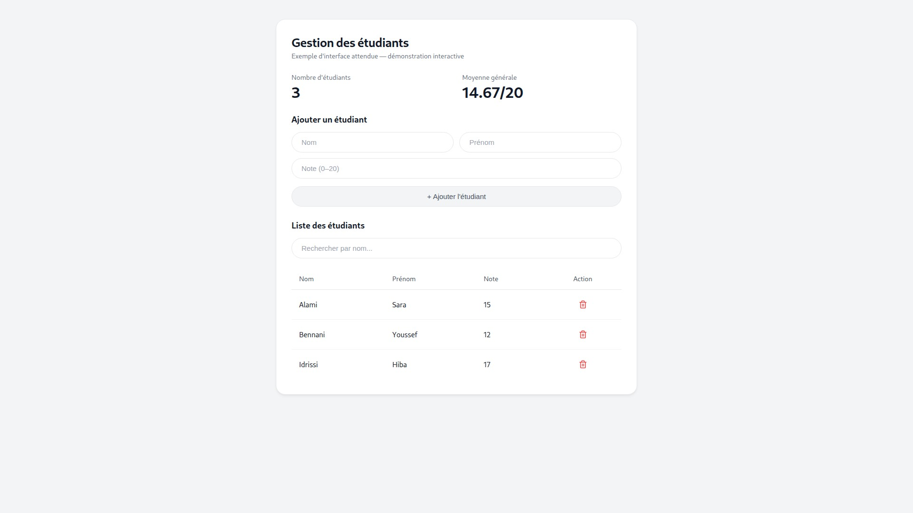
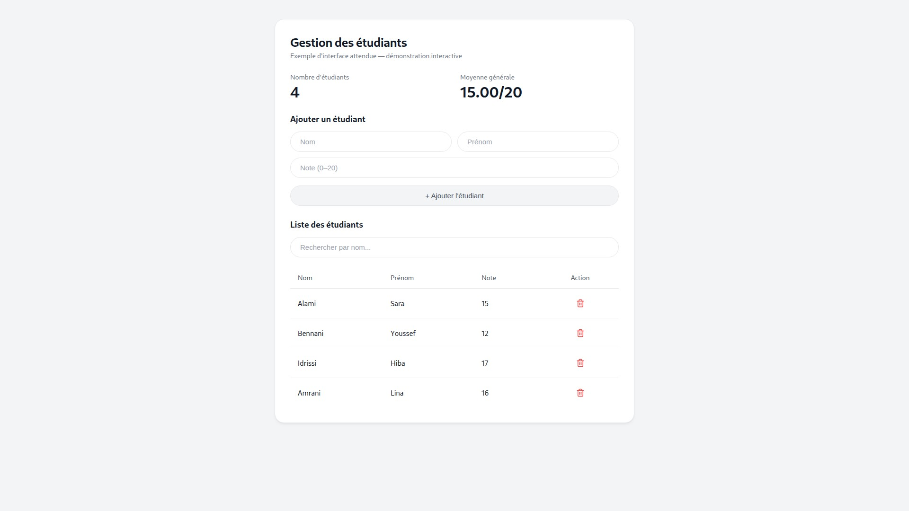
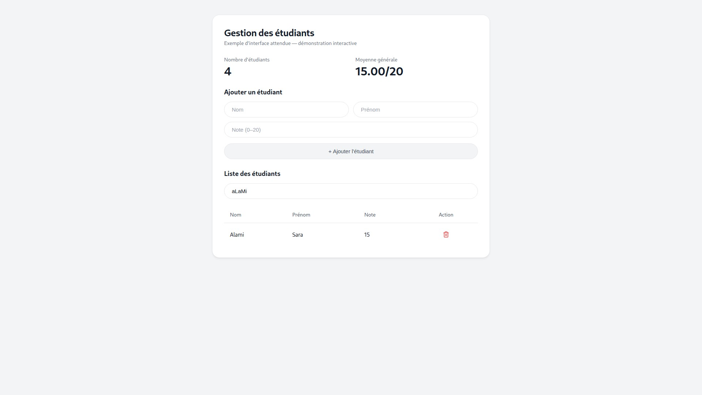
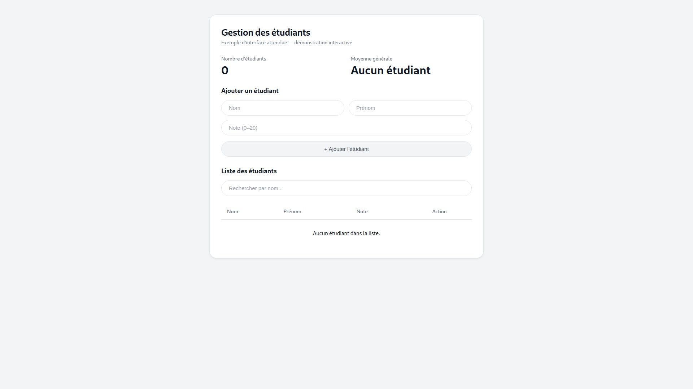

# Gestion des étudiants

Application React avec Vite : affichage, ajout, recherche et suppression d’étudiants, avec calcul du nombre total et de la moyenne des notes.

## Lancement

```bash
npm ci
npm run dev
```

Ouvrir l’URL affichée dans le terminal.

## Vérification

```bash
npm run lint
npm run build
```

Lint et build réussis. Ajout, validation des champs, recherche par nom et suppression vérifiés dans le navigateur.

## Captures

Liste initiale : 3 étudiants, moyenne de 14.67/20.



Ajout de Lina Amrani avec la note 16 : 4 étudiants, moyenne de 15.00/20 et formulaire réinitialisé.



La recherche « aLaMi » retrouve Alami sans distinction entre majuscules et minuscules.



Après suppression de tous les étudiants, le compteur indique 0 et le message « Aucun étudiant » apparaît.


